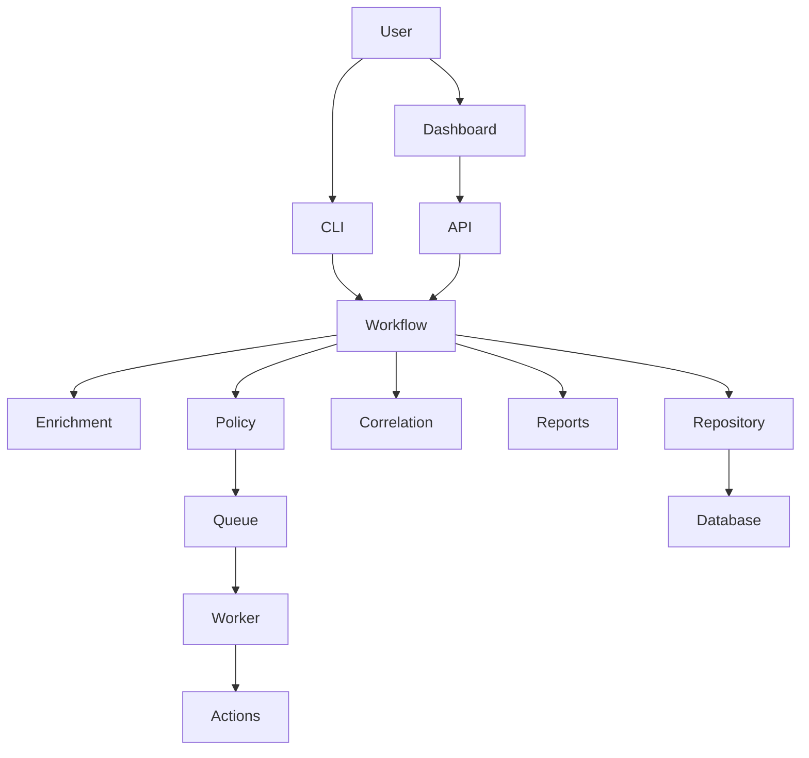

# Project Audit Report

## 1. Project Overview

This repository implements a SOAR-style malware response workflow with four real execution paths:

- CLI execution through `main.py`
- HTTP execution through `api/app.py`
- Analyst operations through the React dashboard in `dashboard/src/`
- Queued remediation execution through `scripts/run_remediation_worker.py`

The shared orchestration layer is `services/workflow_service.py`. It coordinates enrichment, policy evaluation, incident correlation, report generation, persistence, and queued remediation handoff.

## 2. Architecture Summary

- Primary backend framework: FastAPI
- Primary frontend: React + TypeScript + Vite
- Legacy frontend kept in repo: `dashboard/app.py` (Streamlit)
- Shared workflow coordinator: `SoarWorkflowService`
- Enrichment path: `enrichment/pipeline.py`
- Policy path: `engine/policy_engine.py` + `engine/action_dispatcher.py`
- Persistence: runtime selection between `SQLiteIncidentRepository` and `SupabaseIncidentRepository`
- Queue worker: `services/remediation_queue.py`
- Authentication and authorization: bearer tokens from `SOAR_AUTH_TOKENS_JSON`, role checks in `security/auth.py`, workspace scoping in `workspace_utils.py`
- Deployment assets: Docker, Docker Compose, GitHub Actions CI, remote release-compose rollout script

## 3. Project Structure

```text
actions/                Local remediation and ticketing adapters
api/                    FastAPI app and transport schemas
dashboard/              React app, Vercel proxy handlers, legacy Streamlit UI
engine/                 Policy loader, evaluator, dispatcher, replay helpers, risk scoring
enrichment/             Threat intel, CMDB, MITRE, and risk orchestration
integrations/           Connector protocols and provider factories
observability/          Runtime metrics, traces, resilience wrappers
policies/               YAML response policy and replay fixtures
reporting/              Markdown, HTML, and optional PDF report generation
security/               Auth and RBAC helpers
services/               Workflow service, queue worker, readiness, incident correlation
storage/                SQLite and Postgres repositories
scripts/                Worker, migration, replay, deployment, pentest, env validation helpers
tests/                  Backend test suite
config/environments/    Local, staging, and production env profiles
docker/                 Backend and dashboard container definitions
```

## 4. Files Removed

| File | Reason | Evidence |
| --- | --- | --- |
| `dashboard/node_modules/` | Local install artifact regenerated from `dashboard/package-lock.json` | Ignored by `.gitignore`; recreated by `npm install`; not referenced as source |
| `dashboard/dist/` | Frontend build output | Regenerated by `npm run build`; Dockerfile builds it from source |
| `dashboard/test-results/` | Playwright smoke-test artifact | Ignored by `.gitignore`; created by smoke tests |
| `output/.pytest_cache/` | Test cache only | `pytest.ini` points cache to `output/.pytest_cache`; not runtime data |
| `dashboard/tsconfig.node.tsbuildinfo` | TypeScript incremental cache | Ignored by `.gitignore`; regenerated by `tsc --noEmit` |
| `dashboard/debug.log`, `dashboard/vite-4175.err.log`, `dashboard/vite-4175.out.log` | Local debug/temp logs | Ignored by `.gitignore`; not referenced by code or scripts |
| Root and package `__pycache__/` directories | Python bytecode cache | Regenerated by Python tooling; not source or config |
| `a2a/` | Empty cache-only directory after removing its `__pycache__` content | Contained no source files and was left empty |

## 5. Files Considered but NOT Removed

| File | Why suspicious | Why kept |
| --- | --- | --- |
| `dashboard/app.py` | Legacy Streamlit UI, not part of primary build, Docker image, or CI flow | Still imports `streamlit`, remains runnable manually, and is referenced in repo documentation |
| Root `.pytest_cache/` | Stale cache directory, ignored by git | Removal failed with Windows access-denied; left untouched rather than forcing a destructive permission change |
| `output/` tree | Contains many generated artifacts and local databases | Active runtime location for reports, logs, ticket store, observability log, and SQLite fallback databases |
| `docs/pentest-report-*.md` and `docs/reports/` | Ignored generated reports | May be useful analyst/security evidence; no proof they are disposable |
| `PROJECT_SOAR_MALWARE_PLAYBOOK.md` | Product-note style document, not part of runtime | Documentation-only file; harmless and potentially still useful to maintainers |

## 6. Unused Dependencies

### Removed

- `python-dateutil`
  - Evidence: no imports or references anywhere in source, tests, scripts, docs, or config searches

### Probably unused, but kept

- `streamlit`
  - Evidence: only imported by legacy `dashboard/app.py`
  - Kept because the legacy UI file still exists and is still executable

## 7. Dead Code

- `dashboard/app.py` is effectively legacy code.
  - It is not the primary dashboard.
  - It is not used by Docker builds.
  - It is not part of the GitHub Actions CI path.
  - It is still manually runnable, so it was reported but not removed.

## 8. Security Findings

### High

- `GET /api/v1/incidents/by-alert/{alert_id}/report/html` is accessible to `incident_read` principals, but the generated HTML report includes sensitive fields such as `username`, `file_path`, `command_line`, and `file_hash`.
  - Evidence: `api/app.py` protects the route with `require_roles(ROLE_INCIDENT_READ)`.
  - Evidence: `reporting/report_generator.py` renders sensitive values directly into the report.
  - Impact: the report endpoint bypasses the default redaction model used by incident detail reads.

### Medium

- `config/environments/development.env` contains a committed development bearer token with wildcard workspace scope and both `incident_process` and `incident_read` roles.
  - Impact: acceptable for local-only dev use, but unsafe if the same profile is reused outside a local environment.

### Dependency hygiene

- `npm install` reported 4 dashboard dependency vulnerabilities (`1 moderate`, `3 high`).
  - This audit did not run `npm audit` or apply dependency upgrades, so the exact packages remain to be triaged.

## 9. Architecture Findings

### High

- Postgres is not feature-parity with SQLite for analyst workflows.
  - Evidence: `storage/incident_repository.py` raises `NotImplementedError` for case updates, notes, bulk updates, approvals, rollback, reopen, overdue approval escalation, and saved-filter writes in `SupabaseIncidentRepository`.
  - Impact: Postgres-backed deployments can ingest and read incidents, but several dashboard mutation flows will fail at runtime.

### Medium

- Schema is defined in two places.
  - Evidence: Postgres schema exists inline in `storage/incident_repository.py` and also in `migrations/postgres/0001_phase7_baseline.sql`.
  - Risk: schema drift and incomplete parity between runtime bootstrap and migration-based deployment.

- Several core files are oversized and combine multiple responsibilities.
  - Main examples:
    - `storage/sqlite_repository.py`
    - `storage/incident_repository.py`
    - `api/app.py`
    - `dashboard/src/services/soarApi.ts`
    - `dashboard/src/components/IncidentDetail.tsx`
    - `dashboard/app.py`
  - Risk: harder reviews, higher blast radius, and easier regression introduction.

- The repo currently carries multiple UI and deployment modes at once.
  - React dashboard
  - Vite proxy dev mode
  - Vercel proxy handlers
  - Docker/Nginx frontend image
  - legacy Streamlit UI
  - Risk: maintenance drift unless ownership and intended support levels are explicit

## 10. Build/Test Results

| Check | Result | Notes |
| --- | --- | --- |
| Python compile validation | PASS | `python -m compileall api actions alert_generator engine enrichment integrations observability reporting schemas security services storage scripts` |
| Backend tests | PASS | `pytest -q` -> `131 passed` |
| Frontend dependency install | PASS | `npm.cmd install` in `dashboard/` |
| Frontend build | PASS | `npm.cmd run build` in `dashboard/` |
| Frontend smoke tests | PASS | `npm.cmd run test:smoke` -> `2 passed` |
| API startup smoke | PASS | `python -m uvicorn api.app:app --host 127.0.0.1 --port 8011`, probed `/health` successfully |
| Lint | N/A | No dedicated lint command is defined in repo manifests |
| Typecheck | PASS | Covered by dashboard build script via `tsc --noEmit` |

## 11. README Changes

- Rewrote `README.md` to reflect the actual codebase instead of earlier assumptions
- Added a real architecture section and Mermaid diagram
- Documented the real entrypoints, provider model, queue worker, deployment paths, and env variables
- Added an explicit note that SQLite currently has a fuller analyst workflow implementation than Postgres

## 12. Architecture Diagram



Full diagrams are in `docs/architecture.md`.

## 13. Recommended Future Improvements

- Finish Postgres feature parity for analyst mutation workflows before treating it as the default production path for the dashboard
- Tighten report artifact authorization so read-only principals cannot bypass incident redaction via HTML report download
- Consolidate Postgres schema ownership into one authoritative source of truth
- Decide whether `dashboard/app.py` should be formally supported, archived, or removed
- Add a dedicated lint command for backend and frontend
- Add automated coverage for report artifact authorization and Postgres-backed mutation behavior
